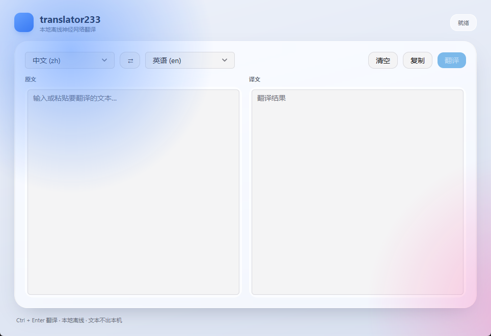

# translator233

本地离线、超轻超快的机器翻译引擎。Go 单文件二进制，零 cgo，自带 **CLI / GUI / HTTP API** 三种入口，专为 **agent** 与终端用户设计。

- **完全离线**：语言包下载后不再联网，无 API Key、无调用费用。
- **零 cgo**：`onnxruntime_go` 需要 C 编译器，这里用 `purego` 直接调用 ONNX Runtime 的 C API，任何机器 `go build` 即可。
- **超快**：常驻服务模式下单次请求 **10–20ms**（含进程启动），首句推理 50–200ms。
- **超轻**：每个语向约 120MB（int8 量化 Marian 模型），运行时按需加载，最多驻留 2 个模型。
- **镜像加速**：GitHub / Hugging Face 下载自动回退到国内镜像（`ghfast.top`、`hf-mirror.com` 等）。

## 快速开始

```bash
# 构建
go build -o bin/translator233 ./cmd/translator233

# 直接翻译：首次运行自动装 ONNX Runtime + 中英语言包，之后即开即用
bin/translator233 translate "你好，世界！" -t en
# Hello, world.

# 常驻服务：CLI 自动复用，延迟从约 500ms 降到约 15ms
bin/translator233 serve
```

首次运行会下载 ONNX Runtime（17MB 运行库）和默认语言包 `zh-en` / `en-zh`；**其他语向在第一次翻译时按需下载**，下载走多连接（默认 8）+ 镜像回退。

| 体积 | 数值 |
| --- | --- |
| 二进制（CLI） | 11.6 MB |
| ONNX Runtime 运行库 | 17.3 MB |
| 每个语向语言包 | 113.6 MB（int8，含 tokenizer） |

## CLI

```bash
translator233 translate <文本...> -t <目标语言> [选项]
translator233 translate --file in.txt -t en
echo "文本" | translator233 translate -f zh -t en --raw
```

| 选项 | 说明 |
| --- | --- |
| `-f, --from` | 源语言，默认 `auto`（脚本 + 常用词启发式检测） |
| `-t, --to` | 目标语言，必填 |
| `--engine` | `auto`（默认，本地优先）/ `local` / `llm` |
| `-j, --json` | 输出 JSON：`{"text":"...","source":"zh","target":"en","pack":"zh-en","engine":"local","segments":1,"cached":false,"ms":61.2}` |
| `--jsonl` | 从 stdin 逐行读取，逐行输出 JSON——最适合 agent 批量调用 |
| `--raw` | 只输出译文，不带速度脚注 |
| `-q, --quiet` | 抑制进度/诊断输出 |
| `--no-auto-install` | 缺语言包时直接报错，不下载 |
| `--no-daemon` | 忽略常驻服务，强制在本进程内推理 |

退出码：`0` 成功，`1` 失败（错误写到 stderr，格式为 `error: ...`）。

### 给 agent 的用法

```bash
# 单条，机器可读
translator233 translate "构建失败，请检查日志" -t en --json

# 批量：每行一条，逐行返回 JSON（失败行返回 {"error": ...} 而不中断）
cat inputs.txt | translator233 translate -f zh -t en --jsonl
```

## 语言包

```bash
translator233 langs                  # 列出全部可用语向（* 表示已安装）
translator233 packs search ja        # 按关键词搜索
translator233 packs install ja-en    # 手动安装
translator233 packs install ja-en -c 16   # 指定并发连接数（默认 8）
translator233 packs list             # 已安装
translator233 packs remove ja-en     # 删除
```

- **默认只装中英**：首次运行时安装 `zh-en` + `en-zh`（各 113.6MB）。
- **其余按需**：其它语向在第一次翻译时自动下载，装一次即可离线使用。
- **多连接下载**：大文件按 4MB 分片、默认 8 路并发（实测 114MB：单连接 13s → 8 连接 6.9s），失败分片自动重试，整条链路再回退镜像。
- **镜像加速**：Hugging Face 优先直连，失败自动切 `hf-mirror.com`；GitHub（ONNX Runtime）回退 `ghfast.top` / `gh-proxy.com` / `ghproxy.net` / `ghp.ci`。

内置 38 个 opus-mt 语向（中文、英语、日语、韩语、法语、德语、西班牙语、俄语、阿拉伯语、意大利语、越南语、泰语、印尼语、土耳其语、荷兰语、波兰语、乌克兰语、印地语、瑞典语、捷克语、芬兰语、丹麦语、罗马尼亚语）。没有直连语向时自动**经英语中转**（例如 `ja → ko` = `ja-en` + `en-ko`）。

安装位置：`~/.translator233/packs/<id>/`，可用 `TRANSLATOR233_HOME` 覆盖根目录（语言包、配置、运行库都不进仓库，见 `.gitignore`）。

### 为什么每个语向是 113MB

| 文件 | 体积 | 说明 |
| --- | --- | --- |
| `encoder.onnx` | 52.7 MB | int8 量化，6 层 Marian 编码器 |
| `decoder.onnx` | 60.0 MB | int8 量化，合并了带/不带 KV cache 的解码器 |
| `tokenizer.json` | 6.4 MB | SentencePiece Unigram 词表（65001 词） |

已实测的其它档位都不划算：`q4` 变体反而更大（146MB + 150MB，因为保留 fp16 激活），`q4f16` 78MB 单边、`uint8` 与 `int8` 同体积。**int8 已是 Hugging Face 上可用的最小档**，且实测质量明显好于 `quantized` 变体（后者会把 `agent` 译成 `<unk>`）。

更进一步只能自己重打包：裁词表（65001 → 32000 左右可省约 30%，代价是生僻词覆盖）或把 encoder/decoder 的共享 embedding 合并成一张图（省一份约 33MB）。这两条都需要图编辑并重新校验输出，暂未内置——若只要体积，直接用下面的在线模式（0 体积）。

## 在线模型（可选，OpenAI 兼容）

本地模型体积固定；如果只是偶尔需要更好的质量，可以接一个 OpenAI 兼容接口（DeepSeek / Ollama / vLLM 都行），语言包体积为零。

```bash
# key 走环境变量，最安全
export DEEPSEEK_API_KEY=sk-...
translator233 config set-llm --base-url https://api.deepseek.com --model deepseek-chat
translator233 translate "这个项目很轻量。" -t en --engine llm
# This project is very lightweight.

translator233 config show        # 查看（key 打码）
translator233 config clear-llm   # 清除
```

- `--engine auto`（默认）：本地优先；本地没有对应语言包且在线模型已配置时才用在线。
- `--engine local`：只用本地，绝不联网。
- `--engine llm`：只用在线模型。
- 配置写在 `~/.translator233/config.json`（0600 权限，已被 `.gitignore` 排除），也可用 `TRANSLATOR233_LLM_BASE_URL` / `TRANSLATOR233_LLM_MODEL` 环境变量覆盖。

## HTTP API

```bash
translator233 serve --addr 127.0.0.1:8765 --open
```

| 接口 | 说明 |
| --- | --- |
| `GET /` | 自带网页界面（深色模式、Ctrl+Enter 翻译） |
| `GET /health` | `{"ok":true,"version":"0.1.0"}` |
| `GET /v1/languages` | 已安装的语言、语言包 |
| `POST /v1/translate` | `{"text":"你好","source":"auto","target":"en"}` |

```bash
curl -s -X POST http://127.0.0.1:8765/v1/translate \
  -H 'Content-Type: application/json' \
  -d '{"text":"你好，世界！","target":"en"}'
```

`serve` 会把监听地址写进 `~/.translator233/daemon.json`，CLI 检测到后自动转发，因此脚本无需改动即可享受常驻服务的延迟。

## GUI

```bash
go build -o bin/translator233-gui ./cmd/translator233-gui
bin/translator233-gui
```



基于 [MyGo](https://github.com/egoist/mygo) 的原生 UI（自绘 GPU 界面，不是 webview，也不是 cgo）：语言下拉、双栏文本区、交换/清空/复制、实时耗时状态。首次启动会在后台自动安装 ONNX Runtime。

## 架构

```
cmd/translator233        CLI + serve
cmd/translator233-gui    MyGo 原生窗口
internal/ort             零 cgo 的 ONNX Runtime 绑定（purego + 生成的 API 偏移表）
internal/marian          Marian 编码器/解码器推理，KV cache，贪心解码
internal/tokenizer       SentencePiece Unigram 分词（tokenizer.json）
internal/translate       服务层：语言包路由、pivot、分句、LRU 缓存、模型 LRU、按需安装
internal/pack            语言包目录 / 安装 / 校验
internal/dl              GitHub / HF 镜像加速 + 分片多连接下载
internal/llm             可选：OpenAI 兼容接口（DeepSeek / Ollama …）
internal/rtsetup         ONNX Runtime 自动安装（zip/tgz 解包）
internal/api             HTTP 接口与内嵌网页
```

### 为什么不用 cgo

`internal/ort` 通过 `purego` 的 `dlopen`/`SyscallN` 直接调用 `OrtGetApiBase` 返回的函数表。函数表成员的偏移由 `tools/genortapi` 从 `onnxruntime_c_api.h` 解析 `struct OrtApi` 生成（当前匹配 ONNX Runtime **1.31**）。换版本只需：

```bash
go run tools/genortapi/main.go <onnxruntime_c_api.h> internal/ort/api_offsets.go
```

## 开发

```bash
go build ./...
go vet ./...
go test ./...
```

`TRANSLATOR233_HOME` 可以指向临时目录，避免污染真实用户目录；`TRANSLATOR233_DEBUG=1` 会打印 daemon 转发失败原因。

## 许可

MIT
